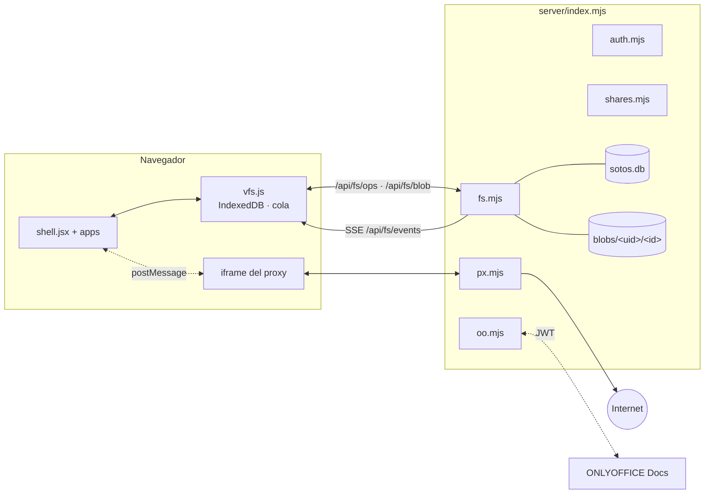
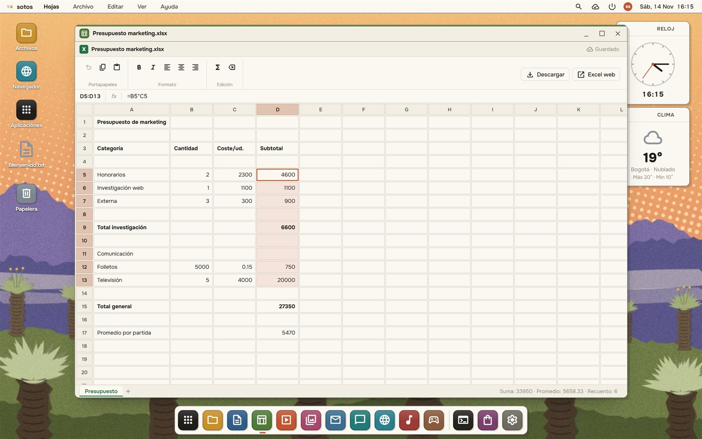
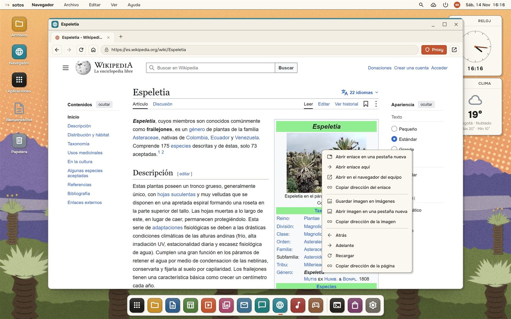
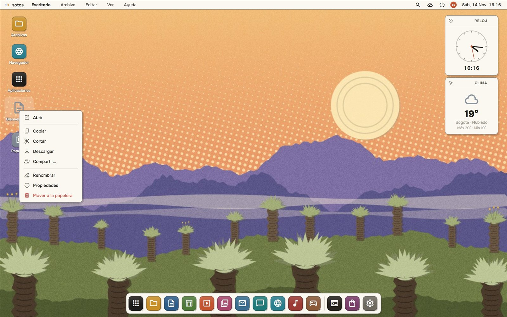
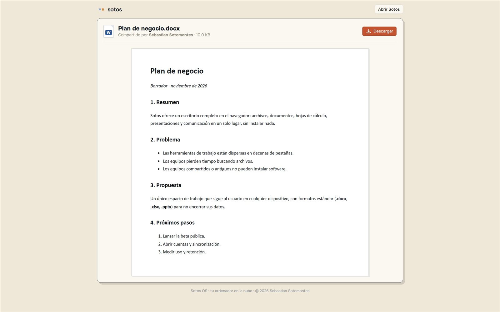
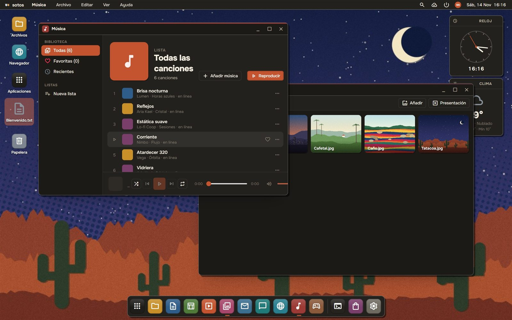

<p align="center"></p>

# Sotos — tu ordenador en la nube

Escritorio completo que corre en el navegador: ventanas, dock, archivos reales en la nube, Word/Excel/PowerPoint con archivos auténticos, navegador con proxy aislado, terminal, compartir con enlaces e identidad visual propia.

© 2026 Sebastian Sotomontes. Todos los derechos reservados. Repositorio de código **privado**; la presentación pública está en `Softsoto/SotosWeb`.

| | |
|---|---|
| Versión | 2.0 |
| Escritorio | React 18 + Vite 6 (`web/`) |
| Servidor | Node.js ≥ 22, sin dependencias de npm (`server/`) |
| Datos | SQLite integrado en Node (`node:sqlite`) + un archivo por contenido; IndexedDB en el navegador |
| Despliegue | Este equipo · servidor Linux con systemd y Caddy · Docker (Caddy + Sotos + servidor de documentos) |

<p align="center"></p>

---

## Índice

1. [Puesta en marcha para desarrollo](#1-puesta-en-marcha-para-desarrollo)
2. [Instalador](#2-instalador)
3. [Variables de entorno](#3-variables-de-entorno)
4. [Estructura del repositorio](#4-estructura-del-repositorio)
5. [Arquitectura](#5-arquitectura)
6. [Sistema de archivos y sincronización](#6-sistema-de-archivos-y-sincronización)
7. [API](#7-api)
8. [Proxy del navegador](#8-proxy-del-navegador)
9. [Formatos de Office y fórmulas](#9-formatos-de-office-y-fórmulas)
10. [Servidor de documentos (ONLYOFFICE)](#10-servidor-de-documentos-onlyoffice)
11. [Identidad visual y fondos](#11-identidad-visual-y-fondos)
12. [Menú contextual global](#12-menú-contextual-global)
13. [Seguridad](#13-seguridad)
14. [Pruebas y capturas](#14-pruebas-y-capturas)
15. [Capturas](#15-capturas)
16. [Pendientes](#16-pendientes)

---

## 1. Puesta en marcha para desarrollo

```powershell
# terminal 1 — servidor (API + proxy) en :8787, solo escucha en este equipo
cd server
npm run dev

# terminal 2 — escritorio con recarga en caliente en :5173 (redirige /api al :8787)
cd web
npm install
npm run dev
```

Abre <http://localhost:5173>. Sin servidor, el escritorio funciona en modo invitado (todo en IndexedDB).

Compilación de producción: `cd web && npm run build` → `web/dist`, que el servidor sirve con `NODE_ENV=production`.

## 2. Instalador

| Script | Sistema | Modos |
|---|---|---|
| `instalar.ps1` | Windows (PowerShell 5.1+) | `equipo`, `docker`, `-Actualizar`, `-Desinstalar` |
| `instalar.sh` | Linux y macOS | `equipo`, `servidor`, `docker`, `actualizar`, `desinstalar` |

```powershell
powershell -ExecutionPolicy Bypass -File instalar.ps1                       # asistente
powershell -ExecutionPolicy Bypass -File instalar.ps1 -Modo equipo -Inicio -Firewall
```
```bash
./instalar.sh                              # asistente
./instalar.sh servidor os.midominio.com    # VPS con HTTPS automático
./instalar.sh docker                       # contenedores (por IP o dominio)
```

**Este equipo** — comprueba Node ≥ 22 (en Windows ofrece instalarlo con winget; en Debian/Ubuntu con NodeSource), compila `web/`, escribe `server/sotos.env` (puerto 8787, proxy 8788, datos en `%LOCALAPPDATA%\SotosOS` o `~/.local/share/sotos-os`, `SOTOS_SHOW_LAN=1`), crea `iniciar-sotos.cmd|sh`, opcionalmente arranque con la sesión (acceso directo en Inicio de Windows o servicio `systemd --user`) y regla de firewall solo para redes privadas. Al terminar imprime `http://localhost:8787` y las IP de la red local.

**Servidor** — copia a `/opt/sotos-os`, compila, crea el usuario de sistema `sotos`, `/etc/sotos-os.env` (600) y la unidad `sotos-os.service` con `ProtectSystem=strict`, `NoNewPrivileges` y `ReadWritePaths=/var/lib/sotos-os`. Con dominio instala Caddy y configura `os.` y `px.`; sin dominio publica por IP con el proxy en `PORT+1` e imprime la IP pública.

**Docker** — genera `.env` con un secreto de 32 bytes. Con dominio usa `docker-compose.yml` (Caddy con HTTPS + Sotos + ONLYOFFICE, tres subdominios); sin dominio escribe `COMPOSE_FILE=docker-compose.ip.yml` (puertos 8787, 8788 y 8080).

## 3. Variables de entorno

| Variable | Por defecto | Uso |
|---|---|---|
| `NODE_ENV` | — | `production` sirve `web/dist` y separa el proxy por host |
| `PORT` | `8787` | Escritorio + API |
| `HOST` | `127.0.0.1` (dev) / `0.0.0.0` (prod) | Interfaz de escucha |
| `PX_PORT` | — | Proxy del navegador en un puerto propio (modo IP) |
| `PX_HOST` | — | Host que se atiende solo como proxy (modo dominio) |
| `PX_PUBLIC` | — | Origen público del proxy que se inyecta en la página |
| `TRUST_PROXY` | — | Confiar en `X-Forwarded-*` (detrás de Caddy) |
| `SOTOS_DATA` | `server/data` | Base de datos, contenidos y secretos |
| `SOTOS_WEB` | `web/dist` | Escritorio compilado |
| `SOTOS_REGISTRATION` | `open` | `closed` impide crear cuentas nuevas |
| `SOTOS_QUOTA_MB` | `2048` | Cuota por cuenta |
| `SOTOS_MAX_FILE_MB` | `512` | Tamaño máximo por archivo |
| `SOTOS_SHOW_LAN` | — | `1` publica las IP de la red en `/api/info` y en Ajustes |
| `OO_URL` | — | URL pública del Document Server (activa la integración) |
| `OO_INTERNAL` | `OO_URL` | URL con la que el servidor descarga lo guardado |
| `SOTOS_INTERNAL` | `http://host.docker.internal:8787` | URL con la que el Document Server llega a Sotos |
| `SOTOS_OO_JWT` | `data/secrets.json` | Secreto JWT compartido con ONLYOFFICE |

## 4. Estructura del repositorio

```
instalar.ps1 · instalar.sh          instaladores (3 modos + actualizar/desinstalar)
Dockerfile · docker-compose*.yml    imagen y despliegues (dominio+HTTPS / IP)
Caddyfile · .env.example            proxy inverso con certificados automáticos
scripts/
  capturas.mjs                      capturas automáticas (Edge sin ventana + CDP)
  onlyoffice-dev.ps1                Document Server local para desarrollo
server/
  index.mjs                         enrutado, estáticos, origen del proxy inyectado
  http.mjs                          utilidades HTTP, límite de intentos, JWT HS256
  db.mjs                            SQLite, rutas de datos, secretos
  auth.mjs                          cuentas, scrypt, sesiones
  fs.mjs                            estado por usuario, operaciones, contenidos, SSE
  shares.mjs                        enlaces públicos y "compartido conmigo"
  oo.mjs                            integración con ONLYOFFICE Docs
  px.mjs                            proxy del navegador (reescritura + cliente inyectado)
web/src/
  main.jsx                          arranque, ruta pública /#/s/<token>
  os/shell.jsx                      SO: arranque, acceso, barra, dock, escritorio, ventanas
  os/tree-ops.js                    operaciones puras del árbol (compartido con el servidor)
  os/vfs.js                         sistema de archivos, IndexedDB, cola y sincronización
  os/api.js · config.js             cliente de la API, origen del proxy
  os/files-ui.jsx                   miniaturas, arrastrar/soltar, menús, propiedades, compartir
  os/apps1.jsx                      Archivos, Notas, Hojas, Galería, guardado automático
  os/apps2.jsx                      Música, Vídeo, PDF
  os/apps3.jsx                      Correo, Mensajes, Navegador
  os/apps4.jsx                      Ajustes (cuenta, fondos, red), Tienda
  os/apps5.jsx                      Documentos, Presentaciones, Lanzador, Papelera
  os/terminal.jsx                   sotos-sh
  os/office.js                      .docx/.xlsx/.csv/.pptx/.pdf, limpieza de HTML, impresión
  os/formula.js                     motor de fórmulas
  os/onlyoffice.jsx                 editor ONLYOFFICE y respaldo con editores propios
  os/context-menu.jsx               menú contextual global
  os/wallpapers.js                  fondos ilustrados por código
  os/seed.js                        contenido de ejemplo real del primer arranque
  os/auth-ui.jsx · share-page.jsx   acceso y página pública de enlaces
```

## 5. Arquitectura



En producción, un host (o un puerto) es solo proxy: las cookies de sesión del escritorio nunca llegan a las páginas proxificadas.

## 6. Sistema de archivos y sincronización

- Estado = `{ root, trash }`. Nodos `{ id, name, type, size, ctime, mtime, children?, url?, meta? }`; `root` y `desktop` son fijos.
- `tree-ops.js#applyOp` implementa `replace`, `create`, `write`, `rename`, `move`, `copy`, `trash`, `restore`, `destroy` de forma pura e idempotente donde aplica; devuelve efectos (`copyBlobs`, `deleteBlobs`) que solo ejecuta el servidor.
- El cliente decide ids (`Date.now().toString(36)` + aleatorio), nombres únicos y fechas, así la operación es determinista.
- Cola: `[{k:"blob",id} | {k:"op",op}]`, persistida en IndexedDB `kv/queue`; las operaciones consecutivas se agrupan (hasta 200 por petición). Errores: 401 → `auth`, 507/413 → `full`, red → reintento cada 5 s.
- Al recibir `fs` por SSE de otro origen: `GET /api/fs/state` y reaplicación de la cola pendiente encima.
- Cuenta nueva: se genera el contenido de ejemplo, se encolan sus blobs y una operación `replace`.
- Bases IndexedDB: `sotos-os` (invitado) y `sotos-os-<uid>` (cada cuenta). Ajustes → Cuenta → Importar copia lo de invitado a la cuenta.

## 7. API

Todas las escrituras exigen `X-Sotos: 1`.

| Método y ruta | Descripción |
|---|---|
| `GET /api/health` · `GET /api/info` | Estado · IP de la red (si `SOTOS_SHOW_LAN=1`) |
| `GET /api/auth/me` | Usuario de la sesión y política de registro |
| `POST /api/auth/register \| login \| logout \| password` | Cuentas |
| `GET /api/fs/state` | `{ version, state, fresh, used, quota }` |
| `POST /api/fs/ops` | `{ ops, origin }` → `{ version }` |
| `GET\|PUT /api/fs/blob/:id` | Contenido (PUT con cuota y límite de tamaño, escritura atómica) |
| `GET /api/fs/events` | SSE: `hello`, `fs` |
| `GET\|POST /api/shares` · `DELETE /api/shares/:token` | Enlaces propios |
| `GET /api/shares/with-me` | Compartido conmigo |
| `GET /api/s/:token[/blob/:id[?dl]]` | Público: metadatos y contenido dentro de lo compartido |
| `GET /api/oo/status` · `POST /api/oo/config` | Integración ONLYOFFICE |
| `GET /api/oo/file?t=` · `POST /api/oo/callback?t=` | Usados por el Document Server, firmados con JWT |

## 8. Proxy del navegador

`/px/<url absoluta>`:

- Petición: reenvía método, cuerpo y cabeceras útiles; cookies desde un jar en memoria por `sotos_px_sid`; `Referer`/`Origin` del sitio real.
- Respuesta: elimina `X-Frame-Options`, CSP, COOP/COEP/CORP, HSTS, `Set-Cookie` (al jar) y similares; redirecciones reescritas; `Access-Control-Allow-Origin: *`.
- HTML: reescritura de `href|src|action|poster|data-src|srcset`, `style` y `<style>` con `url()`/`@import`, `meta refresh`, eliminación de `<base>`, `integrity` y `nonce`, e inyección del cliente.
- Cliente inyectado: parchea `fetch`, `XMLHttpRequest`, `window.open`, `history.pushState/replaceState`, `sendBeacon`, `Worker`, observa el DOM, informa `{type:"sotos-px", url, title}` y reenvía el clic derecho como `{type:"sotos-ctx", …}`; ejecuta `{type:"sotos-cmd"}` (insertar texto, borrar, seleccionar todo) solo si viene de `window.parent`.
- Peticiones con ruta raíz huérfana (`/static/x.js`) → 307 al último origen (por `Referer` o cookie `sotos_px_origin`).
- SSRF: resuelve DNS y rechaza loopback, privadas, CGNAT, enlace local y multicast.
- Cookies del proxy: `SameSite=None; Secure` bajo HTTPS o `localhost`; `SameSite=Lax` por IP en HTTP (mismo sitio que el escritorio).

## 9. Formatos de Office y fórmulas

| Librería | Uso |
|---|---|
| mammoth | `.docx` → HTML |
| docx | HTML → `.docx` (títulos, listas numeradas con definición propia, tablas, imágenes en data URL, formato de texto) |
| ExcelJS | `.xlsx` ↔ modelo `{ sheets:[{ name, cells, fmt, widths }] }`, fórmulas con resultado en caché |
| PptxGenJS + JSZip | `.pptx`; el modelo de Sotos se guarda en `sotos/slides.json` y se declara `Extension="json"` en `[Content_Types].xml` |
| propio | CSV (separador `,` o `;`, comillas), PDF de texto (Helvetica, WinAnsi, xref) |

`formula.js`: tokenizador → parser por precedencia → evaluador con memoria y ciclo. Referencias `A1`, `$B$2`, `AA10`, rangos; funciones en inglés y español. Sin `eval` ni `Function`.

## 10. Servidor de documentos (ONLYOFFICE)

`withOnlyOffice(App)` envuelve Documentos, Hojas y Presentaciones: con cuenta y `OO_URL` configurado usa el editor ONLYOFFICE; si no, el propio.

1. `POST /api/oo/config` → config firmada (`document.key = id-mtime-size`, URL de descarga y de callback con JWT de 12 h/48 h).
2. El navegador carga `OO_URL/web-apps/apps/api/documents/api.js` y crea el editor en su propio iframe.
3. Callback con estado 2 o 6: se verifica el JWT de la URL y el del cuerpo o cabecera, se comprueba que la descarga venga del host del Document Server, se escribe de forma atómica y se aplica una operación `write` (llega por SSE a los demás dispositivos).

Desarrollo local: `scripts/onlyoffice-dev.ps1` (requiere Docker) y reiniciar `npm run dev` del servidor. **Estado: implementado, pendiente de prueba de extremo a extremo con Docker.**

## 11. Identidad visual y fondos

- Tokens de papel y tinta (`--surface`, `--ink-line`, `--print-shadow`…) para claro y oscuro; sin `backdrop-filter`.
- Ventanas con controles propios a la derecha, franja superior del color de la app y sombra desplazada.
- Paleta de acentos: arcilla `#c4532f`, musgo `#4f7a3a`, cielo `#2f5d8a`, mostaza `#c9902a`, ciruela `#7a3e6b`, laguna `#1f7a78`.
- `wallpapers.js`: 8 escenas deterministas (semilla por id) con tramado de puntos, capas con desfase de registro, elementos propios (frailejón, palma de cera, cactus, capilla, ciudad) y grano de papel; se renderizan a la resolución de la pantalla y se cachean como URL de blob.

## 12. Menú contextual global

`context-menu.jsx` escucha `contextmenu` en `document` después de las apps: si ninguna llamó a `preventDefault`, construye el menú según el destino (campo editable, selección, enlace, imagen, barra de título o ventana). Los botones del menú no roban el foco (`mousedown.preventDefault`), así se conserva la selección. `showMenu(x, y, items)` lo usa el Navegador para las páginas proxificadas. `Mayús + clic derecho` deja el menú nativo.

## 13. Seguridad

- scrypt (N = 2¹⁵, r = 8, p = 1) con sal de 16 bytes; sesiones de 30 días, token de 32 bytes, se guarda su SHA-256.
- Límite de intentos: registro 5/h por IP; inicio de sesión 20/15 min por IP y 8/15 min por correo.
- Cookie `Secure` solo bajo HTTPS (detectado por socket o `X-Forwarded-Proto` con `TRUST_PROXY`).
- Identificadores de archivo validados con `^[a-z0-9]{6,40}$` antes de tocar disco; escritura en `.part` + `rename`.
- Contenido compartido: `nosniff`, CSP `sandbox` (salvo PDF), descarga forzada para tipos no seguros.
- `sanitizeHtml` con lista blanca de etiquetas y atributos para documentos, pegado e impresión (iframe sin `allow-scripts`).
- Cabeceras del escritorio: `X-Frame-Options: DENY`, `nosniff`, `Referrer-Policy`, `Permissions-Policy`.

## 14. Pruebas y capturas

- Prueba de humo de la API (registro, sesión, operaciones, blobs, enlaces públicos, anti-CSRF, borrado definitivo): 20/20.
- Formatos: los `.docx`, `.xlsx`, `.pptx` y `.pdf` generados se validaron abriéndolos con librerías independientes en Node.
- Fórmulas: casos de precedencia, rangos, columnas de varias letras, ciclos, división por cero y nombres desconocidos.
- Sincronización: cuenta nueva → borrado de la caché local → todo vuelve del servidor, incluido el contenido.

Capturas automáticas (servidor y `web` en marcha):

```powershell
node scripts/capturas.mjs docs/capturas
```

Lanza Edge sin ventana a 1600×1000 (densidad 1,5), usa una cuenta local de capturas y recorre el sistema mediante `window.__sotos` (solo existe en desarrollo) y eventos reales de ratón y teclado por CDP.

## 15. Capturas

| | |
|---|---|
|  |  |
|  |  |
|  |  |
|  |  |
|  |  |
|  |  |

## 16. Pendientes

- Probar ONLYOFFICE de extremo a extremo (Docker) y fijar `OO_VERSION`.
- Comprobar la sintaxis de `instalar.sh` en Linux real.
- Bloque 3: ventanas y pantallas táctiles (gestos, modo celular).
- Bloque 4: calculadora, calendario, tareas, cámara, mapas, editor de código; chat entre cuentas por WebSocket; tienda funcional.
- Bloque 5: rendimiento (carga diferida de apps, subconjunto de la fuente de iconos), CSP estricta, límites del proxy por cuenta, publicación.
