
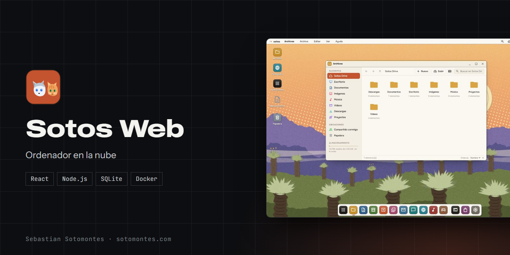

Un ordenador completo dentro del navegador: archivos en la nube, Word, Excel y PowerPoint, correo real, calendario, tareas, navegador propio, terminal y una identidad visual propia. También es un homenaje a inevio.

<a href="https://sotomontes.com/#sotos-web">Ver en sotomontes.com</a> · <a href="#recorrido">Recorrido</a> · <a href="#instalación">Instalación</a> · <a href="#cómo-funciona-por-dentro">Cómo funciona</a> · <a href="#novedades">Novedades</a> · <a href="CHANGELOG.md">Historial de cambios</a> · <a href="#un-homenaje-a-inevio">Homenaje a inevio</a>

| Ficha técnica | |
|---|---|
| **Autor** | Sebastian Sotomontes |
| **Tipo** | Escritorio web · ordenador en la nube |
| **Plataforma** | Cualquier navegador moderno (Chrome, Edge, Firefox, Safari), en computador, tableta o celular |
| **Servidor** | Este equipo (Windows, Linux, macOS), servidor Linux o Docker |
| **Versión** | 3.0 · lanzamiento oficial |
| **Estado** | Funcional |
| **Stack** | React 18 · Vite · Node.js 24 · SQLite · IndexedDB · Docker · Caddy · ONLYOFFICE / Euro-Office · Neko |
| **Licencia** | [MIT](LICENSE) |

---

## Qué es

Sotos es un sistema operativo de escritorio que vive en una pestaña del navegador. Tiene ventanas, dock, escritorio con iconos, menú contextual, búsqueda global y más de quince aplicaciones. Los archivos son reales: se guardan en el servidor con tu cuenta y te siguen a cualquier dispositivo, o se quedan en el propio navegador si lo usas como invitado.

Los documentos se abren y se guardan en sus formatos de siempre (`.docx`, `.xlsx`, `.pptx`, `.pdf`), así que cualquier archivo creado en Sotos se puede descargar y seguir editando en otro programa, y al revés.

## Un homenaje a inevio

Sotos también es un homenaje a **inevio**, aquel escritorio en la nube que demostró hace años que un sistema operativo completo podía vivir en una pestaña del navegador. El tema Grafito, el movimiento de las ventanas y muchas de las funciones de las versiones 2.2 y 2.3 (correo, calendario, tareas, bandeja de recibidos, versiones de archivos, grupos de contactos, presencia y tienda) rinden tributo a lo que inevio hizo posible.

Sotos no usa código, gráficos ni recursos de inevio: todo está escrito desde cero. inevio es una marca de sus respectivos dueños y Sotos no tiene relación con ella.

## Novedades

**Versión 3.0, lanzamiento oficial** ([historial completo](CHANGELOG.md)):

- **WhatsApp dentro de Sotos**: cada cuenta vincula su WhatsApp con un código QR y lo usa con la interfaz de Sotos: chats, fotos, videos, audios, documentos y archivos de tu nube.
- **Bóveda secreta**: un espacio oculto y cifrado con tu propia clave; ni el servidor ni un administrador pueden ver lo que guardas.
- **Paint**, **Diagramas** (draw.io), **Pizarra** (Excalidraw) y **Código** (el editor de VS Code), todos guardando en tus archivos.
- **Correo profesional**: varias cuentas, alias con remitente principal, firma y editor en HTML.
- **Películas MKV con audio y subtítulos**: el servidor las prepara una vez sin perder calidad de imagen; luego se ven como un video normal, eligiendo audio y subtítulos.
- **Gestor de transferencias**, **avatares**, **iconos arrastrables**, logo clásico a elegir y un panel de administración para revisar archivos carpeta por carpeta con registro de cada acción.

**Versión 2.3**, Sotos se vuelve tu oficina completa:

- **Correo real** con tus cuentas de Gmail, Outlook, iCloud, Yahoo o cualquier otro proveedor: carpetas, búsqueda, leer, responder, reenviar, destacar, mover y adjuntar archivos de Sotos. Puedes vincular **varias cuentas** y añadir **alias** para enviar desde otras direcciones, por ejemplo tu dominio propio en iCloud+.
- **Calendario y Tareas**: varios calendarios, recordatorios, eventos compartidos en los mundos, importar y exportar `.ics`; listas de tareas con fechas, prioridades y comentarios.
- **Versiones de archivos**: cada documento guarda sus versiones anteriores para verlas, descargarlas o restaurarlas, y una copia de seguridad completa de tu cuenta se exporta e importa desde Ajustes.
- **Enviar a…**: manda uno o varios archivos o carpetas a otra cuenta; llegan a su bandeja de **Recibidos** para aceptarlos o rechazarlos.
- **Personas**: quién está en línea, grupos de contactos y bloqueo.
- **Tienda**: herramientas y juegos que se instalan al instante en tu cuenta, con reseñas de estrellas.
- **Panel de administración**: usuarios, cuotas, registro abierto o cerrado y estadísticas del servidor.
- **ONLYOFFICE o Euro-Office**: editores de oficina completos dentro de Sotos, probados con ambos motores.
- **Navegador virtual y WhatsApp**: un Firefox real en el servidor abre las páginas que no se dejan mostrar dentro de otra web, y la app de **WhatsApp** lo usa para tener WhatsApp Web dentro de Sotos.
- **Juegos** separados con portadas propias, **11 widgets** (temporizador, calculadora, recientes, reloj mundial, monedas, sistema…), miniaturas de vídeo, carátulas de música, símbolos en las carpetas del sistema, descompresor de `.zip`, `.7z`, `.rar` y `.tar`, y eliminar definitivamente desde la Papelera.

**Versión 2.1**, Sotos se vuelve un lugar para compartir con otras personas:

- **Mundos**: espacios compartidos con tu familia, amigos o equipo, con muro de publicaciones y comentarios, carpeta en común y chat en vivo.
- **Notificaciones**: una campana en la barra superior avisa al instante cuando te invitan a un mundo, te comparten un archivo o alguien publica, comenta o sube algo.
- **Contactos**: agenda propia que importa y exporta `.vcf` (celular, Gmail, Outlook) y reconoce quién ya tiene cuenta en Sotos.
- **Visor de PDF propio**: miniaturas, texto seleccionable, búsqueda dentro del documento, zoom, rotación, imprimir y pantalla completa.
- **Música con carátulas**: título, artista, álbum y portada se leen de las etiquetas de cada MP3.
- **Tema Grafito**: un segundo estilo para todo el sistema, gris y carbón, con dock lateral, ventanas planas y fondo en blanco y negro, en claro y oscuro.

**Versión 2.0**, reconstrucción completa del proyecto original:

- **Archivos reales** con almacenamiento en la nube por cuenta, caché local y funcionamiento sin conexión.
- **Cuentas**, sincronización en vivo entre dispositivos y **enlaces para compartir** con permisos y caducidad.
- **Word, Excel y PowerPoint** que leen y escriben archivos de Office auténticos, con fórmulas y guardado automático.
- **Navegador propio** que abre cualquier página dentro de Sotos gracias a un proxy aislado.
- **Terminal** con comandos reales sobre tus archivos.
- **Identidad visual nueva** de papel y tinta, con ocho fondos ilustrados de paisajes colombianos.
- **Menú contextual** en todo el sistema, también dentro de las páginas web.
- **Instalador** para tres escenarios: tu propio equipo, un servidor o Docker.

## Recorrido

### Acceso

Al abrir Sotos se elige entre iniciar sesión, crear una cuenta o probarlo como invitado. La hora y el fondo del sistema acompañan la pantalla de bienvenida.

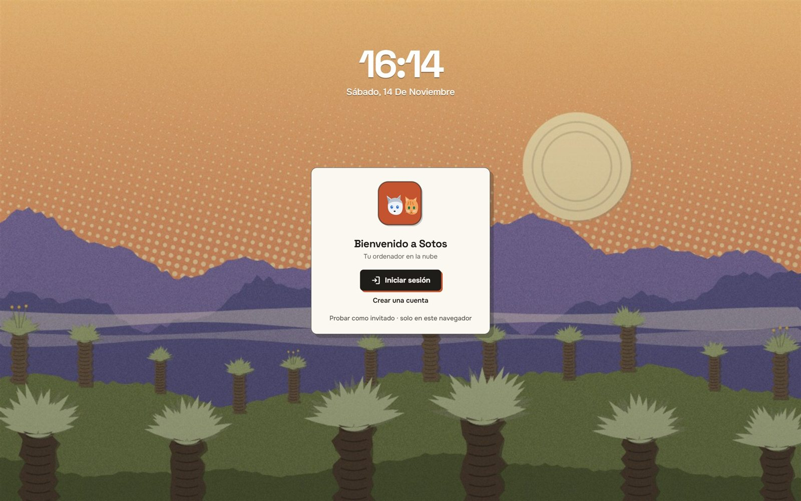

### Archivos

Explorador completo: iconos o lista con columnas, orden por nombre, fecha, tamaño o tipo, selección múltiple, arrastrar y soltar (también carpetas enteras desde el equipo), copiar, cortar, pegar, renombrar, papelera con deshacer, descarga de carpetas como `.zip`, extracción de `.zip` y propiedades de cada elemento. La barra lateral muestra el espacio usado real de tu cuenta.

### Documentos

Editor de texto enriquecido que abre y guarda `.docx` reales: fuentes, tamaños, color, resaltado, listas, alineación, títulos, citas, tablas, imágenes y enlaces. Exporta a PDF, guarda solo mientras escribes y limpia el formato peligroso de lo que se pega desde otras páginas.

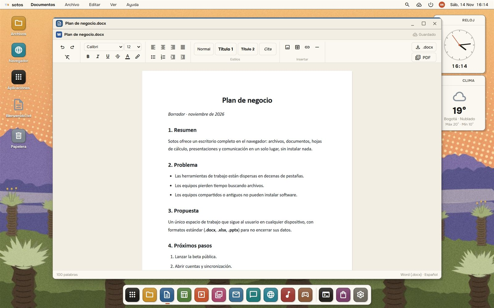

### Hojas de cálculo

Abre y guarda `.xlsx` y `.csv` con varias hojas. Tiene su propio motor de fórmulas (`SUM`, `AVERAGE`, `IF`, `ROUND`, `CONCAT` y más, también con sus nombres en español), selección de rangos con la suma, el promedio y el recuento al pie, autosuma, negrita, cursiva, alineación, copiar y pegar compatible con otras hojas de cálculo y deshacer.

### Presentaciones

Diapositivas de título y de viñetas, fondos de la paleta de Sotos, reordenar, duplicar y modo presentación a pantalla completa con teclado. Guarda `.pptx` reales que se abren en PowerPoint, y al volver a Sotos se recupera la presentación sin pérdidas.

### Terminal

Una consola con comandos de verdad sobre tus archivos: `ls`, `cd`, `tree`, `mkdir`, `touch`, `cat`, `head`, `tail`, `echo` con redirección, `cp`, `mv`, `rm`, `find`, `grep`, `du`, `wc`, `open` y `download`. Tiene autocompletado con Tab, historial con las flechas y comillas para nombres con espacios.

### Navegador

Pestañas, historial, barra de direcciones con búsqueda y un **modo proxy** que abre dentro de Sotos páginas que normalmente prohíben mostrarse dentro de otra web. La barra de direcciones y el título siguen la navegación dentro de la página, y el clic derecho sobre enlaces e imágenes ofrece abrir en otra pestaña o guardar la imagen en tus archivos.

### Menú contextual en todo el sistema

El clic derecho funciona en cualquier lugar: archivos, escritorio, dock, barras de título (minimizar, maximizar, ajustar a media pantalla), campos de texto (deshacer, cortar, copiar, pegar, buscar en la web), enlaces, imágenes y páginas web abiertas en el Navegador.

### Fondos e identidad

Ocho fondos ilustrados que Sotos dibuja a la resolución exacta de tu pantalla: Páramo, Cerros, Cafetal, Caño, Tatacoa, Caribe, Papel y Tinta. También se puede usar cualquier foto propia como fondo.

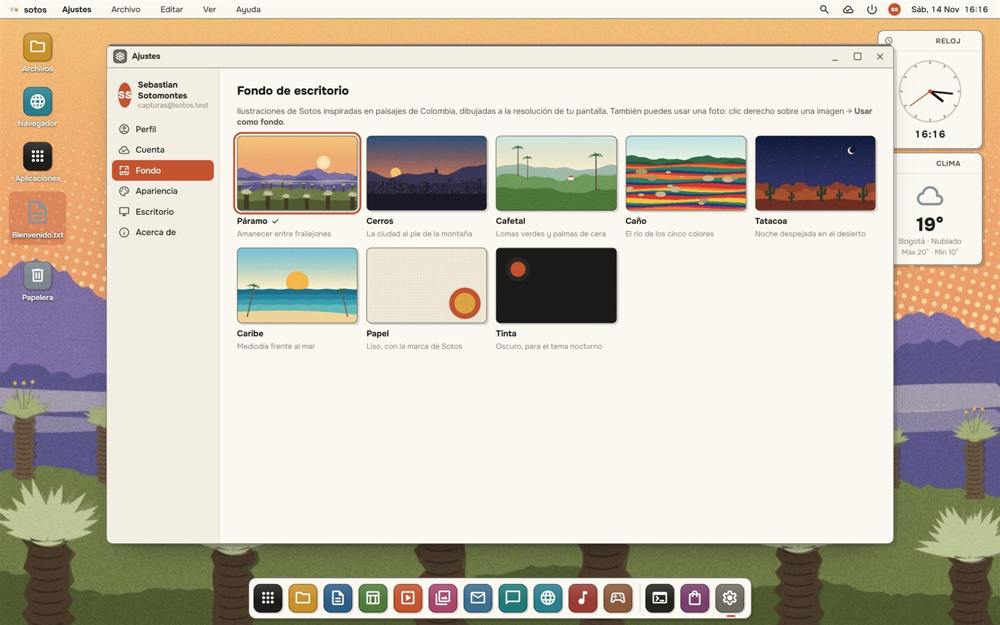

### Compartir

Cualquier archivo o carpeta se comparte con un enlace: para cualquiera o solo para cuentas concretas, con permiso de lectura o de edición y con caducidad opcional. Los enlaces activos se pueden copiar o revocar.

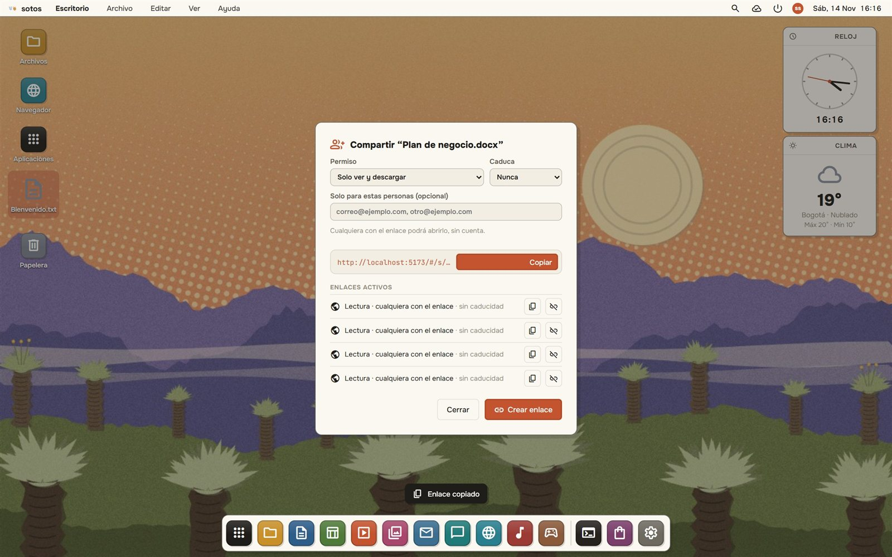

Quien recibe el enlace no necesita cuenta: ve el documento directamente en el navegador (Word, Excel, PDF, imágenes, audio, vídeo y texto) y lo puede descargar.

### Mundos

Un mundo es un espacio compartido entre varias cuentas. Tiene un **muro** para publicar y comentar, una **carpeta en común** a la que se arrastran archivos desde el equipo o desde tus propios archivos de Sotos, y un **chat**. Todo se actualiza en vivo en los navegadores de todos los miembros, sin recargar. Quien crea el mundo elige nombre, icono y color, invita por correo y puede quitar miembros.

### Notificaciones

La campana de la barra superior cuenta lo que no has visto y muestra un aviso en cuanto llega algo nuevo. Al pulsar una notificación se abre directamente el mundo, la pestaña o el documento compartido.

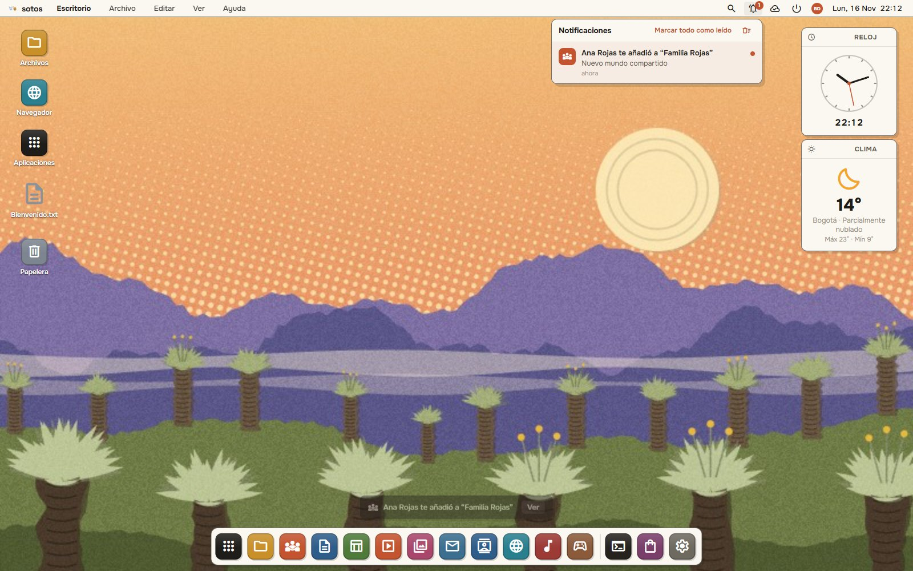

### Contactos

Agenda con búsqueda, ficha de cada persona, importación y exportación `.vcf`. Los contactos que ya usan Sotos se marcan y se pueden añadir a un mundo con un clic.

### Visor de PDF

Visor propio con miniaturas de las páginas, texto que se puede seleccionar y copiar, búsqueda con resaltado, ajuste al ancho o a la página, rotación, impresión, descarga y pantalla completa.

### Música

La biblioteca lee las etiquetas de cada canción para mostrar título, artista, álbum, año y carátula, también en los controles multimedia del sistema.

### Tema Grafito

Además de la identidad de papel y tinta, Sotos trae un segundo estilo completo: **Grafito**. Dock lateral oscuro de arriba abajo, ventanas planas en gris, barras laterales con el elemento activo en verde, carpetas grises, tipografía Lato y el fondo convertido a blanco y negro. Se elige en **Ajustes → Apariencia** y funciona en claro y en oscuro.

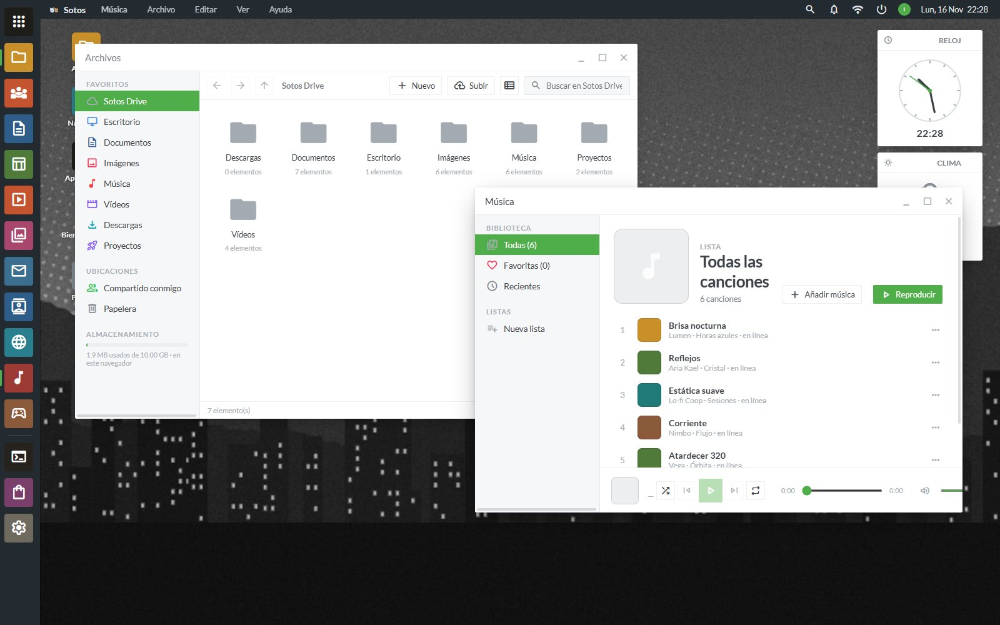

### Correo

Varias cuentas, alias para enviar desde otras direcciones y la elección de remitente al redactar. Los correos en HTML se muestran aislados y sin scripts, y las imágenes externas quedan bloqueadas hasta que las pidas, para que nadie sepa que abriste su mensaje.

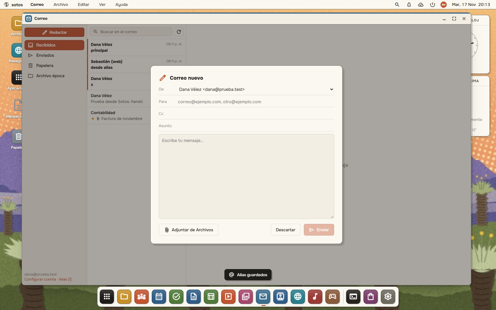

### Calendario y Tareas

### Versiones y Tienda

### WhatsApp, correo y video

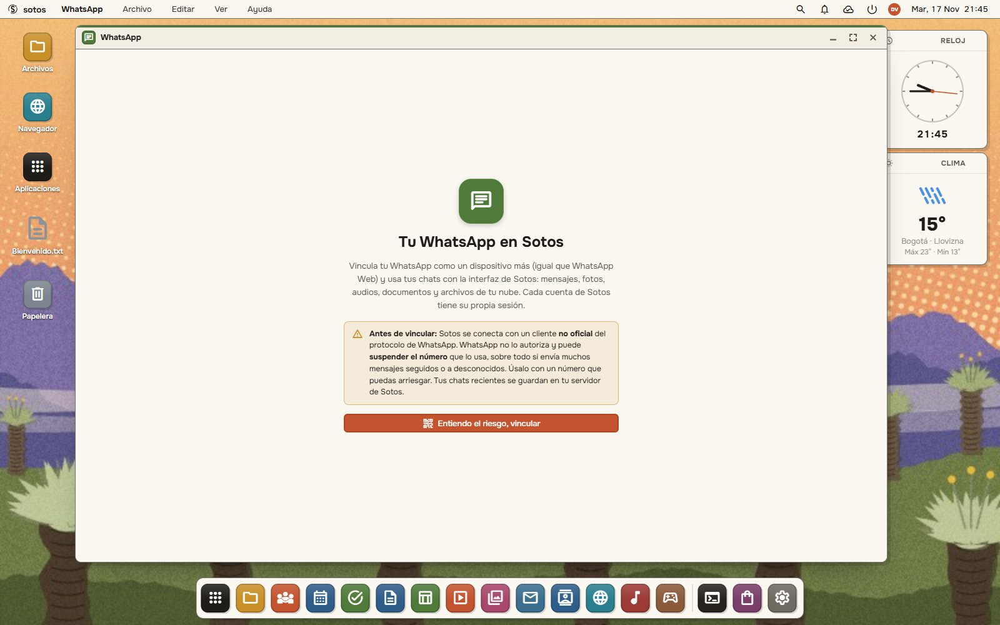

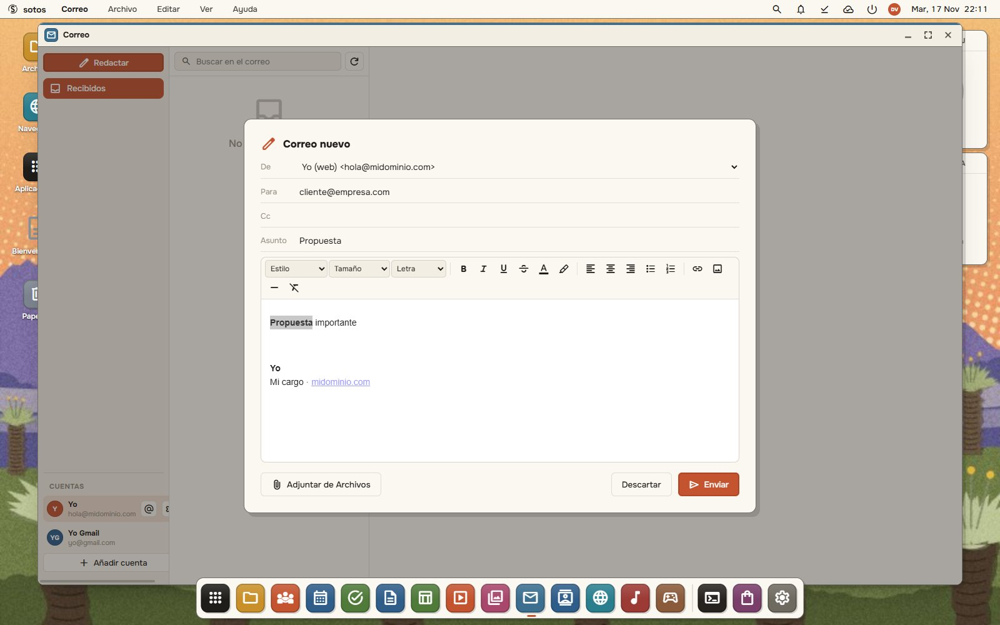

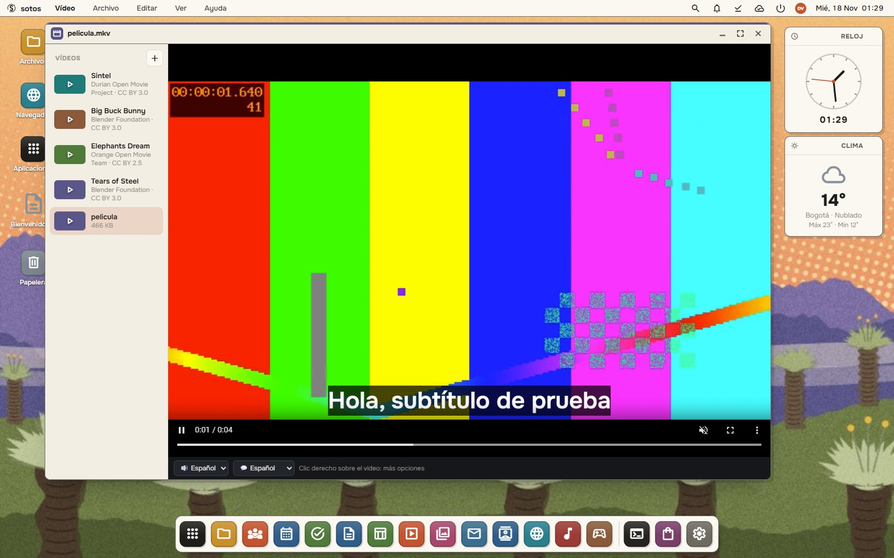

### Paint, Diagramas y avatares

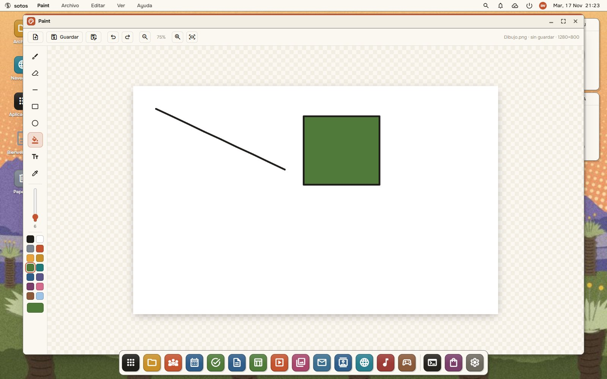

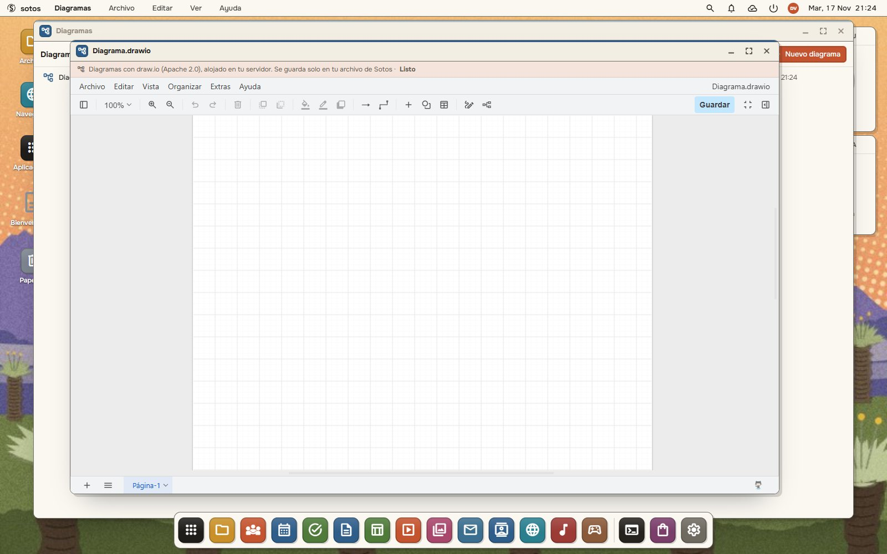

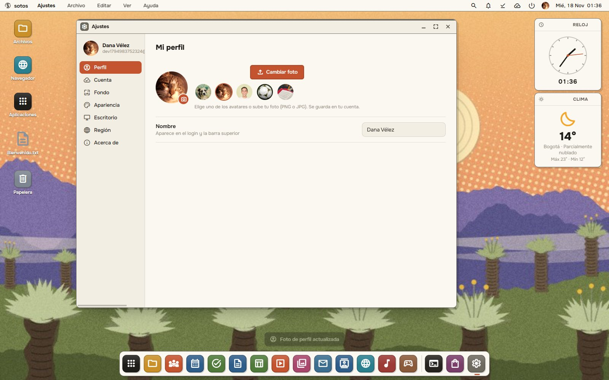

### Euro-Office dentro de Sotos

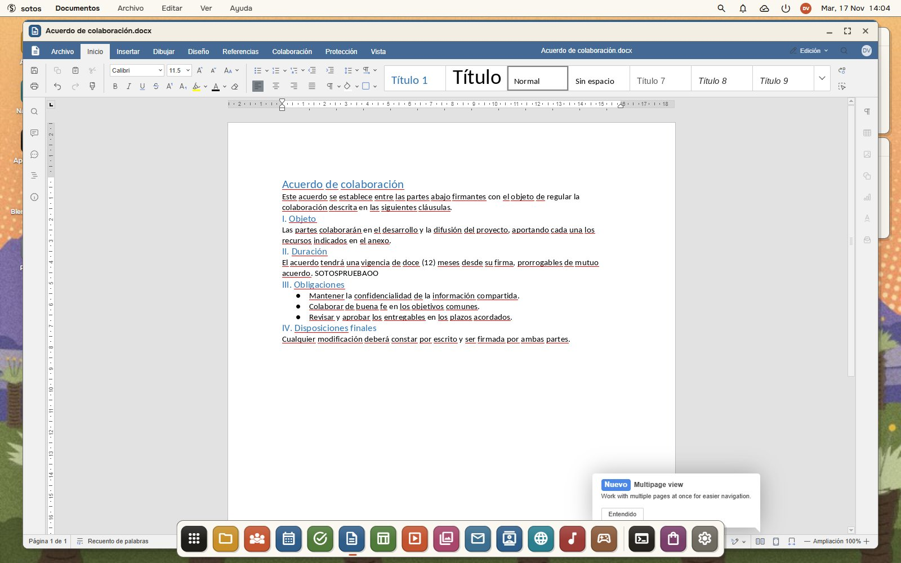

### Navegador virtual

### Juegos y widgets

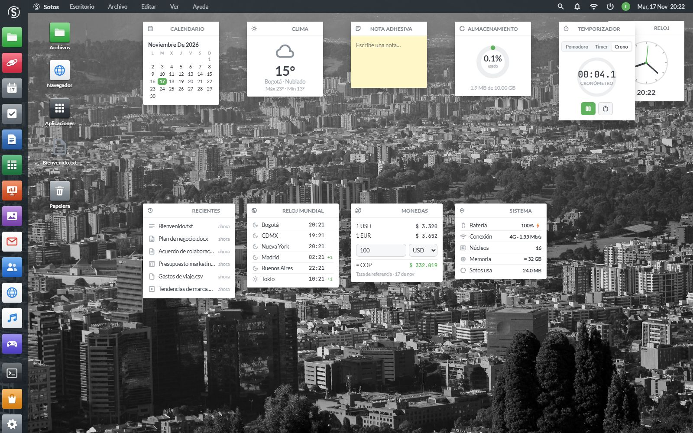

### Tema oscuro

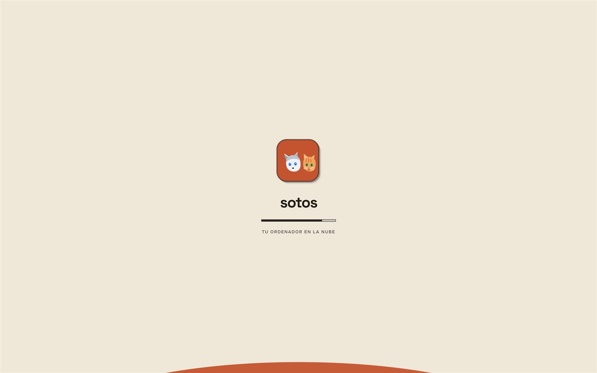

## Cómo se usa

1. Abre la dirección de tu Sotos en cualquier navegador y **crea una cuenta**, o pulsa **Probar como invitado** para usarlo sin registrarte.
2. Arrastra archivos o carpetas desde tu equipo a la ventana de **Archivos** o al escritorio. Se suben a tu nube.
3. Haz doble clic en cualquier archivo: se abre en la aplicación adecuada. Los documentos se guardan solos.
4. Crea documentos, hojas o presentaciones nuevas desde **Archivo → Nuevo**, con el botón **Nuevo** de Archivos o con el clic derecho.
5. Pulsa **Ctrl + K** para buscar cualquier aplicación o archivo.
6. Clic derecho sobre un archivo → **Compartir…** para generar un enlace.
7. En **Ajustes** cambia el estilo (Sotos o Grafito), el fondo, el tema, el color de acento, la tipografía, el estilo de las ventanas y la posición del dock.
8. Desde otro computador o desde el celular inicia sesión con la misma cuenta: todo está ahí.

### Atajos

| Atajo | Acción |
|---|---|
| `Ctrl + K` / `Ctrl + Espacio` | Buscar apps y archivos |
| `Ctrl + C`, `Ctrl + X`, `Ctrl + V` | Copiar, cortar y pegar archivos |
| `Supr` / `F2` / `Enter` | Papelera, renombrar, abrir |
| `Ctrl + A` | Seleccionar todo |
| `Ctrl + S` | Guardar ya (en editores) |
| `Ctrl + Z` | Deshacer (Hojas) |
| `Tab` / `↑` `↓` | Autocompletar e historial en la Terminal |
| `Mayús + clic derecho` | Menú nativo del navegador |

## Funciones

- **Escritorio**: ventanas que se mueven, se redimensionan, se maximizan y se ajustan a media pantalla; dock que se reordena; iconos en el escritorio; widgets de reloj, calendario, clima real, notas y almacenamiento; búsqueda global.
- **Archivos**: explorador completo, papelera con restauración a la carpeta original, subida de carpetas, `.zip`.
- **Oficina**: Documentos (`.docx`), Hojas (`.xlsx`, `.csv`), Presentaciones (`.pptx`), visor de PDF con búsqueda y miniaturas, Notas con resaltado de líneas y vista previa de HTML y Markdown.
- **Multimedia**: Galería con presentación y uso como fondo; Música con carátulas, listas, favoritas, aleatorio, repetición y teclas multimedia del sistema; Vídeo.
- **Internet**: Navegador con proxy, accesos directos y servicios con reproductor oficial (YouTube, Spotify, mapas).
- **Personas**: Mundos (muro, carpeta y chat compartidos), notificaciones en vivo y Contactos con `.vcf`.
- **Nube**: cuentas, sincronización en vivo, funcionamiento sin conexión, cuota de espacio, compartir con enlaces, "Compartido conmigo".
- **Personalización**: ocho fondos ilustrados o una foto propia, tema claro u oscuro, seis colores de acento, cuatro tipografías y tres estilos de ventana.
- **Correo**: varias cuentas IMAP/SMTP con alias, contraseñas cifradas en el servidor.
- **Organización**: Calendario con recordatorios e `.ics`, Tareas con comentarios, versiones de archivos y copias de seguridad.
- **Creatividad**: Paint, Diagramas (draw.io), Pizarra (Excalidraw) y Código (Monaco).
- **Privacidad**: bóveda secreta cifrada con tu propia clave.
- **Extras**: Terminal, Juegos, Tienda, WhatsApp, widgets, avatares y panel de administración con registro de acciones.

## Instalación

Sotos se instala con un asistente que pregunta dónde va a vivir y deja todo funcionando. Al terminar muestra las direcciones para entrar, incluida la **IP de tu red**, para abrirlo desde el celular u otro computador.

| Modo | Para qué | Qué hace el instalador |
|---|---|---|
| **Este equipo** | Usarlo en casa o en la oficina, para ti y tu red local | Comprueba o instala Node.js, compila el escritorio, guarda los datos en tu carpeta de usuario, puede arrancar Sotos con el sistema y abrir el firewall solo para redes privadas. Muestra `http://localhost:8787` y `http://TU-IP:8787`. |
| **Servidor / hosting** | Un VPS Linux accesible desde internet | Instala Sotos como servicio `systemd` con usuario propio y permisos mínimos, que se reinicia solo. Con dominio configura **HTTPS automático** con Caddy; sin dominio publica por IP y muestra tu IP pública. |
| **Docker** | Despliegue en contenedores | Genera la configuración con un secreto aleatorio y levanta Sotos junto al servidor de documentos (ONLYOFFICE o Euro-Office). Por IP o con tres subdominios y HTTPS. |

Los tres modos usan la misma compilación: la dirección del proxy del navegador se decide al arrancar, no al compilar. El instalador también **actualiza** y **desinstala** sin tocar tus archivos.

Requisitos: Node.js 22 o superior (el instalador lo ofrece si falta), o Docker. Para el servidor de documentos en Docker se recomiendan 4 GB de RAM.

## Cómo funciona por dentro

### Arquitectura

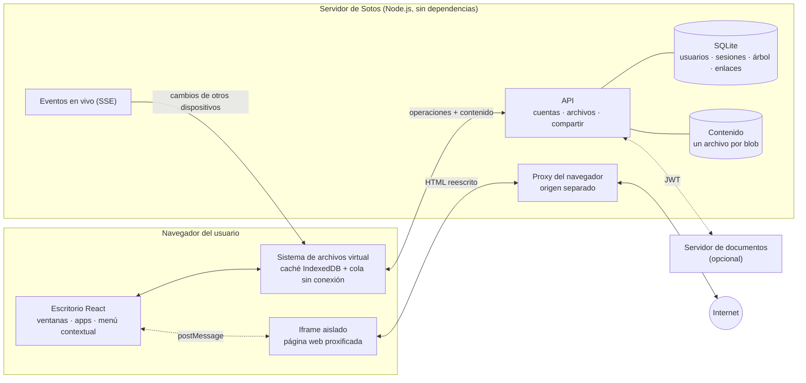

### Archivos: operaciones en lugar de copias

Cada cambio (crear, escribir, renombrar, mover, copiar, enviar a la papelera, restaurar, borrar) es una **operación pequeña y determinista**: identificadores, nombres y fechas los decide el cliente al momento. El mismo módulo aplica las operaciones en el navegador y en el servidor, así dos dispositivos llegan siempre al mismo árbol sin enviarse el árbol completo.

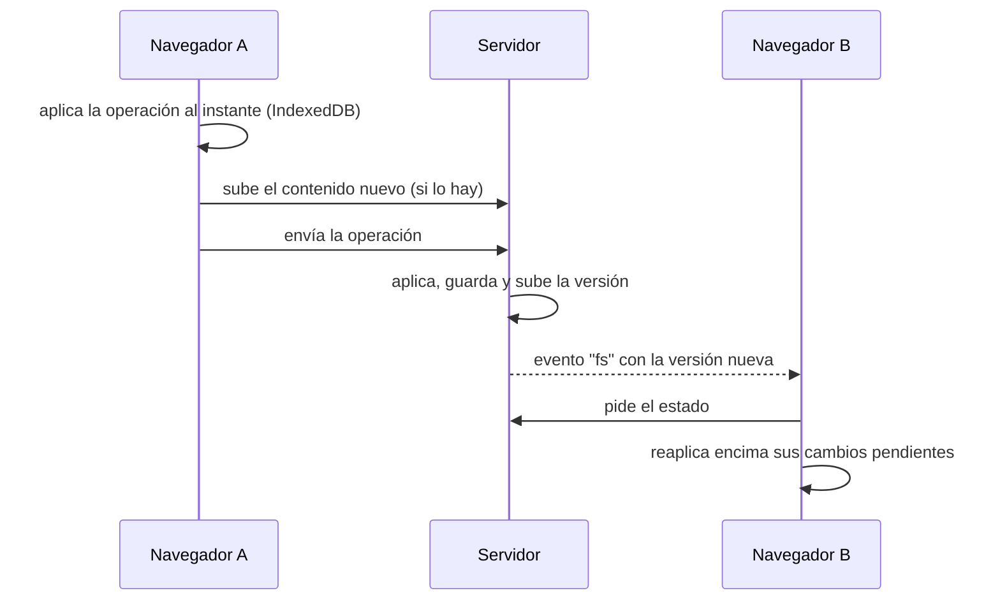

- El contenido siempre se sube **antes** que la operación que lo referencia, y la cola se procesa en orden.
- Sin conexión, las operaciones esperan en una cola guardada en IndexedDB y se envían al volver.
- Cada cuenta tiene su propia caché local; el modo invitado usa otra, así nunca se mezclan.
- Los archivos se descargan bajo demanda y se guardan en caché.
- El servidor controla la cuota de cada cuenta y el tamaño máximo por archivo.

### Documentos de Office

| Formato | Lectura | Escritura |
|---|---|---|
| `.docx` | HTML a partir del documento, con limpieza de etiquetas y atributos | HTML del editor convertido en párrafos, títulos, listas numeradas y con viñetas, tablas, imágenes y formato de texto |
| `.xlsx` | Valores, fórmulas, negrita, cursiva, alineación y anchos de columna | Fórmulas con su resultado calculado, para que otros programas muestren el valor sin recalcular |
| `.pptx` | Texto de cada diapositiva | Diapositivas reales más el modelo de Sotos dentro del propio archivo, declarado en su lista de tipos de contenido |
| `.pdf` | Visor del navegador | Generador propio de PDF de texto para los archivos de ejemplo; exportación de documentos por impresión |

Las librerías de formatos se cargan solo cuando se abre un archivo de ese tipo.

### Motor de fórmulas

Analizador propio: tokenizador, gramática por precedencias (comparación, concatenación, suma, producto, potencia, signo) y evaluador con memoria por celda y detección de referencias circulares. Nunca ejecuta código del documento, a diferencia de evaluar la fórmula como JavaScript, y devuelve los errores habituales (`#DIV/0!`, `#NOMBRE?`, `#VALOR!`, `#REF!`, `#CICLO!`).

### Navegador y proxy

Casi todos los sitios prohíben mostrarse dentro de otra página. El proxy de Sotos descarga la página, quita esas restricciones y reescribe enlaces, formularios, redirecciones, `srcset`, CSS y metadatos para que todo vuelva a pasar por él. Además inyecta un pequeño cliente que redirige `fetch`, `XMLHttpRequest`, `window.open` y el historial, y avisa al escritorio de la dirección y el título reales.

- Se sirve desde un **origen distinto** al del escritorio: una página abierta nunca puede leer la sesión ni los archivos de Sotos.
- Las cookies de cada sitio se guardan en el servidor por visitante, así los inicios de sesión sencillos funcionan.
- Bloquea direcciones privadas y locales para que no se pueda usar contra la red interna.
- El clic derecho dentro de la página se envía al escritorio por `postMessage`, y las acciones de pegar o seleccionar vuelven a la página por el mismo canal.

### Servidor de documentos: ONLYOFFICE o Euro-Office

Con ONLYOFFICE Docs o con Euro-Office (su versión europea, con la misma interfaz de programación), Documentos, Hojas y Presentaciones pueden abrir editores de oficina completos dentro de Sotos. El servidor firma con JWT la configuración, la descarga del archivo y el aviso de guardado, valida el origen de cada versión nueva y la guarda como una operación más, así el resto de dispositivos la recibe al instante. Si no hay servidor de documentos, o se usa Sotos como invitado, se usan los editores propios. Ambos motores están probados de punta a punta: lo que se escribe en el editor vuelve guardado al `.docx` y la versión anterior queda en el historial.

### Correo sin intermediarios

El servidor de Sotos habla directamente con tu proveedor por IMAP y SMTP, con un cliente y un lector MIME escritos para Sotos, sin librerías externas. Las contraseñas de correo se guardan cifradas (AES-256-GCM) y nunca vuelven al navegador. En iCloud se entra con la dirección principal @icloud.com y una contraseña específica para apps; el dominio propio se añade como alias.

### Fondos ilustrados

Cada fondo es una escena dibujada por código en un `<canvas>` a la resolución de la pantalla, imitando una serigrafía:

1. Cielo plano con **tramado de puntos** que crece hacia el horizonte.
2. Capas de color plano (montañas, ciudad, río, mar) con un **desfase de registro**: cada capa se imprime primero en un tono más oscuro y corrido unos píxeles.
3. Elementos propios de cada paisaje: frailejones con tronco lanudo y roseta de hojas, palmas de cera, cactus, una capilla en la cima, ventanas iluminadas.
4. **Grano de papel** y fibras sobre todo el conjunto.

Las escenas usan un generador pseudoaleatorio con semilla, así cada fondo sale siempre igual. Las imágenes de ejemplo de la Galería son esas mismas ilustraciones.

### Identidad visual

Papel y tinta: superficies de color crema, bordes de tinta y sombras desplazadas como de lámina impresa, sin cristal difuminado ni brillos. La paleta de acentos (arcilla, musgo, cielo, mostaza, ciruela y laguna) colorea también los iconos de las aplicaciones y las carpetas color manila. El logo actual es una S de dos arcos con una órbita abierta. El logo original, un husky y una gata, sigue en «Acerca de» y se puede volver a elegir como logo de todo el sistema en **Ajustes → Apariencia**.

### Seguridad

- Contraseñas con **scrypt** y sal; la sesión es un token aleatorio en una cookie `HttpOnly` y en la base de datos solo se guarda su huella.
- Límite de intentos de inicio de sesión por IP y por correo, y el mismo coste de cálculo exista o no la cuenta.
- Toda petición que modifica datos exige una cabecera propia que un formulario de otra web no puede enviar.
- Los identificadores de archivo se validan antes de tocar el disco.
- El contenido compartido se sirve con `nosniff` y en una caja aislada; HTML y SVG nunca se muestran en el origen de Sotos.
- El HTML de los documentos se limpia al abrir, al pegar y al imprimir.
- En servidor, el servicio corre con usuario propio, sistema de archivos de solo lectura salvo sus datos y sin privilegios nuevos.

## Limitaciones conocidas

- Algunos sitios con protección contra bots o aplicaciones muy pesadas (inicios de sesión de grandes plataformas, banca) no funcionan a través del proxy. Para ellos está el botón para abrirlos en una pestaña real.
- Entrando por IP sin HTTPS, el navegador no deja a Sotos leer el portapapeles para la opción de pegar del menú; `Ctrl + V` sigue funcionando.
- El servidor de documentos necesita Docker y unos 4 GB de RAM.
- El navegador virtual (y con él WhatsApp) es uno por servidor: lo comparte quien tenga acceso a él.
- La interfaz está solo en español por ahora.

**Créditos:** React, Vite, mammoth, docx, ExcelJS, PptxGenJS, JSZip, pdf.js, libarchive.js, Material Symbols, fuentes Onest, Hanken Grotesk, Space Grotesk, Lato y JetBrains Mono, Caddy, ONLYOFFICE Docs, Euro-Office, Neko, el servicio de clima Open-Meteo y las tasas de ExchangeRate-API. Fondos fotográficos de dominio público (CC0). Gracias a Basted y Lyanna.

Homenaje a inevio. Sotos no está afiliado a inevio ni a sus dueños.

---

© 2026 Sebastian Sotomontes · Licencia [MIT](LICENSE).
